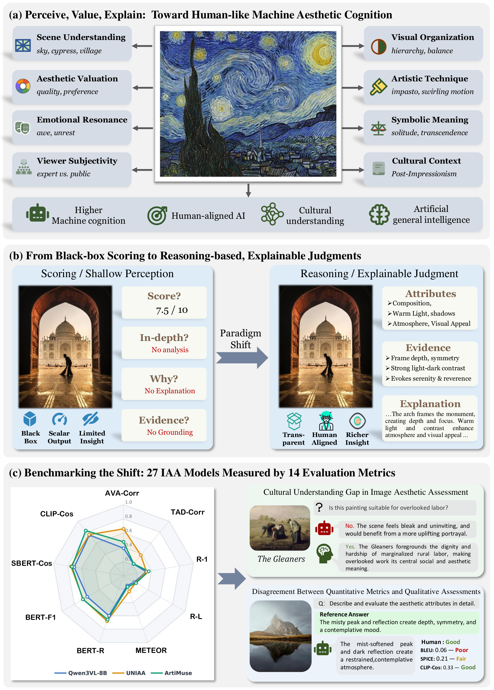
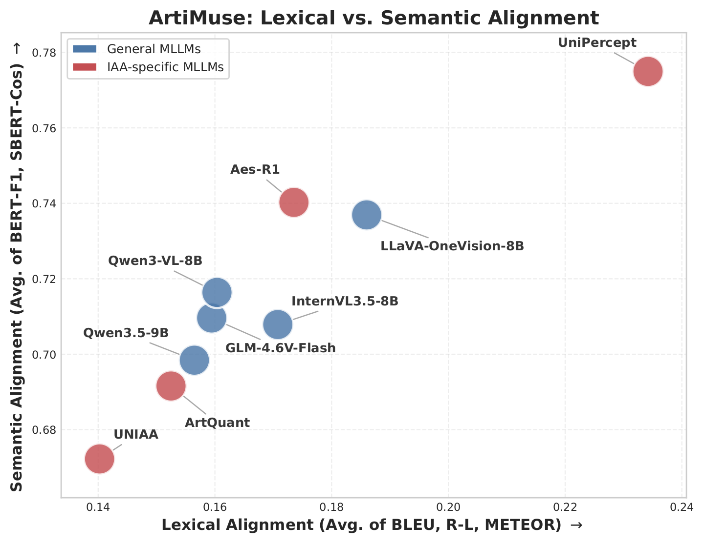
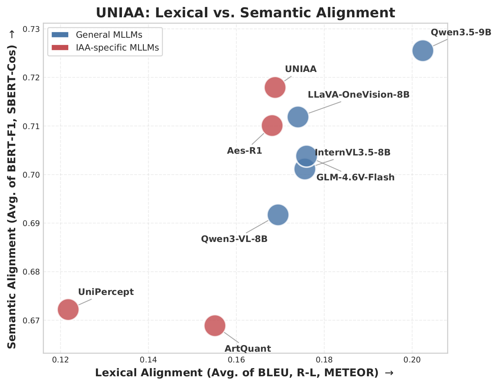
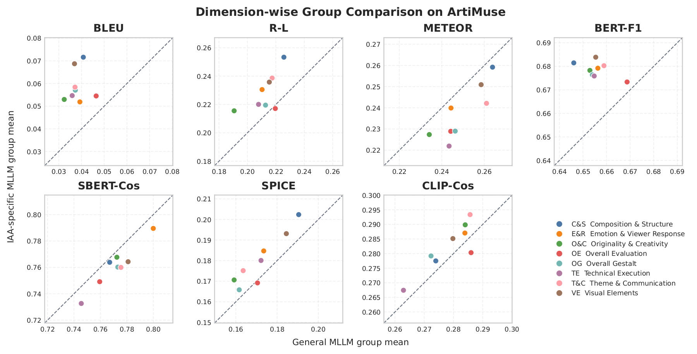

# Aesthetic Evaluation

English · [简体中文](README_zh-CN.md)

[](https://github.com/An-Moon/Aesthetic-evaluation/actions/workflows/ci.yml)
[](https://github.com/An-Moon/Aesthetic-evaluation/releases/tag/v0.1.0)
[](LICENSE)
[](pyproject.toml)

An aesthetic score can summarize preference, but it does not explain which
visual choices support a judgment. Our paper traces the shift from predicting
scores to writing critiques grounded in the image. We benchmark 27 models with
14 metrics and use qualitative cases to show what automatic metrics can miss,
including visual evidence and cultural context.

This repository provides fixed evaluation protocols, model adapters, and
scripts for reproducible inference and offline evaluation, plus an experimental
toolbox for aesthetic score prediction.

<p align="center">
  <a href="assets/figures/paper-figure-1.png"></a>
</p>

[Benchmarks](#benchmarks) · [Results](#benchmark-highlights) ·
[Quick start](#quick-start) · [Evaluation](#evaluation)

## Benchmarks

| Task | Benchmark | Public protocol | Evaluation size |
|---|---|---|---:|
| Dimension-conditioned description | ArtiMuse-10K | 0-shot and 16-shot text-only | 7,984 |
| Aesthetic description | UNIAA-Bench | fixed-first 1-shot text-only | 500 |

The [experimental score-evaluation toolbox](aesthetic_eval_score_framework)
is provided separately. This checkout does not include numerical AVA or TAD66K results.

## Benchmark highlights

The paper figures below summarize the experiments. Numeric exports, full
predictions, and benchmark references are not included in this checkout. Click
any figure to open it at full resolution.

### Description: lexical versus semantic alignment

<p align="center">
  <a href="assets/figures/artimuse-description.png"></a>
  <a href="assets/figures/uniaa-description.png"></a>
</p>

Each point represents a model. The horizontal axis averages BLEU, ROUGE-L,
and METEOR; the vertical axis averages BERT-F1 and SBERT-Cos. The highest-scoring
model on these axes changes from UniPercept on ArtiMuse (0-shot) to Qwen3.5-9B on
UNIAA (fixed text-only 1-shot). Because the benchmark and prompting protocol
both change, this comparison does not isolate the effect of either one.

### ArtiMuse: comparison across eight aesthetic dimensions

<p align="center">
  <a href="assets/figures/artimuse-dimensions.png"></a>
</p>

Points above the diagonal favor the IAA-specific group; points below it favor
the general group. On this comparison, BLEU and BERT-F1 favor the specialist
group in all eight dimensions, while METEOR and SBERT-Cos favor the general
group. These are descriptive group means, not tests of statistical significance.

## Model support

| Model family | Released status |
|---|---|
| InternVL3.5-8B, GLM-4.6V-Flash, Qwen3.5-9B, Qwen3-VL-8B, LLaVA-OneVision-8B | validated |
| UNIAA, UniPercept, Aes-R1 | validated |
| ArtiMuse | ArtiMuse Description is `in_domain_only` |
| ArtQuant | Description retained with a template-output caveat |
| Q-SiT, AesExpert | adapters are public, but Description outputs are `invalid_for_protocol` |

Task-specific checkpoint paths and runtime options are defined in
[`configs/models/examples`](configs/models/examples). Files marked
`experimental` are not validated members of the main comparison.

## Quick start

### 1. Clone and install the framework

Python 3.10 is recommended for model inference. The lightweight CI checks run
on Python 3.10 and 3.11.

```bash
git clone https://github.com/An-Moon/Aesthetic-evaluation.git
cd Aesthetic-evaluation

python -m venv .venv
source .venv/bin/activate
python -m pip install --upgrade pip
python -m pip install -e .

python run.py --help
```

This installs the portable framework dependencies. GPU model stacks are
installed separately because the evaluated checkpoints require mutually
incompatible Transformers versions.

### 2. Configure local paths

```bash
cp .env.example .env
# Edit .env so every path points to an existing local resource.

set -a
source .env
set +a
```

The repository does not load `.env` implicitly. It must be sourced in every new
shell, or the variables must be exported by another environment manager.

Required variables:

```text
AESTHETIC_DATA_ROOT
AESTHETIC_MODEL_ROOT
AESTHETIC_OUTPUT_ROOT
AESTHETIC_METRIC_MODEL_ROOT
AESTHETIC_JAVA
```

Keep `AESTHETIC_OUTPUT_ROOT` outside the Git checkout when possible. Missing or
unresolved variables are fatal rather than silently replaced.

### 3. Download datasets and checkpoints

Datasets and model weights are not redistributed.

- [ArtiMuse-10K](https://huggingface.co/datasets/Thunderbolt215215/ArtiMuse-10K)
- [UNIAA official repository](https://github.com/KlingAIResearch/Uniaa)

Expected dataset layout:

```text
$AESTHETIC_DATA_ROOT/
├── Artimuse/
│   ├── images/
│   └── text/{train.jsonl,test.jsonl}
└── UNIAA/A_UNIAA_Bench/
    └── description/
```

Model directories must match the `model_path` in the selected YAML under
[`configs/models/examples`](configs/models/examples). Checkpoints are always
loaded locally; the framework never substitutes a downloaded model at runtime.

### 4. Create a model-specific environment

The exact release environments are recorded under
[`configs/environments`](configs/environments). They are version manifests,
not directly installable requirements, because the appropriate PyTorch build
depends on the host CUDA driver.

For example, the Qwen/InternVL/GLM release environment used Python 3.10 with
PyTorch 2.11.0, torchvision 0.26.0, Transformers 5.5.4, Accelerate 1.13.0,
PEFT 0.18.1, and timm 1.0.26:

```bash
conda create -n aesthetic-qwen python=3.10 -y
conda activate aesthetic-qwen

# Install the PyTorch 2.11.0 build appropriate for your CUDA driver first.
python -m pip install torchvision==0.26.0
python -m pip install \
  transformers==5.5.4 accelerate==1.13.0 peft==0.18.1 timm==1.0.26
python -m pip install -e .
```

Use the recorded `llava37`, `llava_onevision`, or `aes_r1` environment for
those model families. Do not upgrade one shared environment until all target
adapters import successfully; separate environments are the reproducible path.

### 5. Prepare description protocols

```bash
python scripts/prepare_uniaa_description_1shot_v1.py \
  --source-root "$AESTHETIC_DATA_ROOT/UNIAA/A_UNIAA_Bench/description" \
  --output-dir "$AESTHETIC_DATA_ROOT/prepared/uniaa_description_1shot" \
  --context-output "$UNIAA_1SHOT_CONTEXT_FILE"
```

For ArtiMuse 16-shot, rebuild the leakage-controlled examples locally:

```bash
python scripts/audit_and_select_artimuse_context.py \
  --root "$AESTHETIC_DATA_ROOT/Artimuse" \
  --output "$ARTIMUSE_CONTEXT_FILE" \
  --audit-output "$AESTHETIC_OUTPUT_ROOT/artimuse_context_audit.json"
```

Preparation scripts validate the expected source count and image availability.
The fixed-first UNIAA Description builder also refuses to overwrite an existing
protocol artifact when its bytes have drifted.

### 6. Run a smoke test

The following command runs the first four prepared UNIAA description samples
with Qwen3-VL:

```bash
CUDA_VISIBLE_DEVICES=0 python run.py infer \
  --base-config configs/protocols/uniaa_description_1shot_greedy_v2.yaml \
  --model-config configs/models/examples/qwen3_vl_8b.yaml \
  --sample-limit 4 \
  --output-root "$AESTHETIC_OUTPUT_ROOT/smoke"
```

Inspect the generated `run_meta.json` and confirm that four non-empty rows were
written to `predictions.jsonl` before starting a full run.

### 7. Run a released protocol

```bash
# UNIAA Description, fixed-first 1-shot, 500 images
CUDA_VISIBLE_DEVICES=0 bash scripts/run_uniaa_description.sh \
  configs/models/examples/qwen3_vl_8b.yaml

# ArtiMuse Description, 0-shot or 16-shot
CUDA_VISIBLE_DEVICES=0 bash scripts/run_artimuse_description.sh \
  configs/models/examples/qwen3_vl_8b.yaml 0shot
```

To resume, pass the original output directory as the final launcher argument.
Resume validates existing IDs and rejects duplicates or rows from another
dataset.

## Evaluation

### Description metrics

Use a dedicated metric environment; its dependencies need not match the model
inference environment:

```bash
conda create -n aesthetic-metrics python=3.10 -y
conda activate aesthetic-metrics
python -m pip install -e '.[metrics]'
```

Download the exact local BERTScore, SBERT, and CLIP checkpoints identified in
the metric YAML, configure Java 8 for SPICE, and then run:

```bash
python run.py eval \
  --pred-file "$AESTHETIC_OUTPUT_ROOT/<run>/predictions.jsonl" \
  --output-file "$AESTHETIC_OUTPUT_ROOT/<run>/metrics_v2.json" \
  --metrics-config configs/metrics/artimuse_description_v2.yaml \
  --by-dimension
```

For UNIAA, use `configs/metrics/uniaa_description_v2.yaml` and omit
`--by-dimension`.

The released metrics are BLEU, ROUGE-L, METEOR, BERT-F1, SBERT-Cos, SPICE, and
CLIP-Cos. `CLIP-Cos` is normalized CLIP image-text cosine, not the scaled metric
commonly called CLIPScore. Metric loading, Java parsing, and model errors stop
the evaluation; they are never converted to `0.0`.

## Output contract

Each inference run creates:

```text
<output-root>/<model>_<task>_<timestamp>/
├── predictions.jsonl
└── run_meta.json
```

`predictions.jsonl` contains sample ID, resolved image, complete prompt,
prediction, reference, dimension, model, task, and timestamp. Treat it as a
private research artifact: it may contain benchmark reference text and local
paths and must not be committed.

`run_meta.json` records the resolved protocol/model configuration, dataset
metadata, context hash, runtime versions, sample counts, and timing.

## Repository layout

```text
run.py                              # infer / eval / eval-progress CLI
src/aesthetic_eval/                 # runtime, adapters, data, metrics
configs/protocols/                  # frozen task protocols
configs/models/examples/            # portable local-checkpoint configs
configs/metrics/                    # strict metric protocols
configs/environments/               # release environment manifests
scripts/                            # preparation, launch, evaluation, export
assets/figures/                     # final rendered result visualizations
aesthetic_eval_score_framework/     # experimental scoring toolbox
```

## Reproducibility boundary

- ArtiMuse results require 7,984/7,984 rows.
- UNIAA Description requires 500/500 rows after removing the fixed first
  text-only example.
- Decoding is greedy with `do_sample: false` and `num_beams: 1`.
- The released Description protocol is a unified cross-model comparison, not a
  direct reproduction of the UNIAA paper's stochastic Description setting.
- Q-SiT and AesExpert are excluded from primary Description results because
  they failed predefined output-behavior checks.
- ArtiMuse is excluded from the primary ArtiMuse group comparison because it is
  trained in-domain.

The YAML files under [`configs/protocols`](configs/protocols) are the canonical
machine-readable protocol definitions. Local `run_meta.json` files record the
fully resolved configuration used by each run.

## License and citation

Original repository code is licensed under Apache-2.0. External checkpoints,
datasets, and optional upstream repositories retain their own terms; see
[`NOTICE`](NOTICE) and the official dataset links in the quick start.

Formal paper metadata is still pending, so the repository intentionally does
not include `CITATION.cff`. Use the GitHub repository and release URL until the
paper citation is published.
