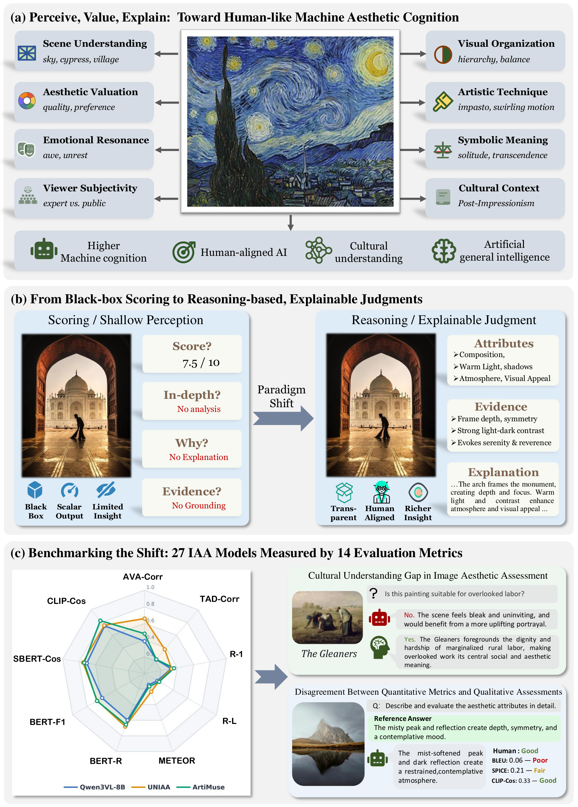
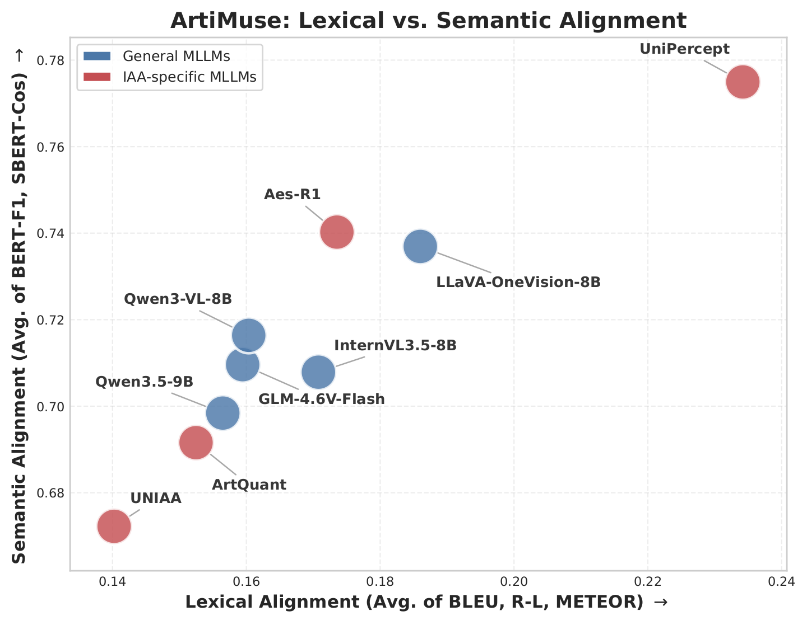
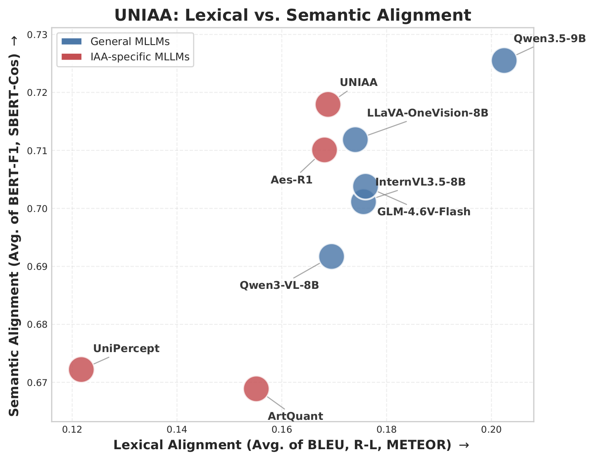
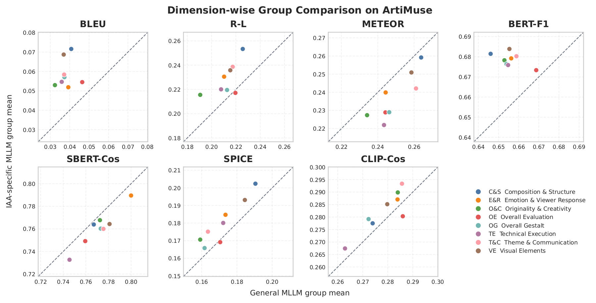

# 图像美学评估（Aesthetic Evaluation）

[English](README.md) · 简体中文

美学分数可以概括偏好，却不能说明哪些视觉细节支撑了这一判断。本文梳理图像美学评估如何从预测分数走向有图像依据的评论，用 14 项指标评估 27 个模型，并通过案例说明自动指标可能忽略哪些视觉证据与文化语境。

本仓库提供固定评估协议、模型适配器、推理与离线评测脚本，便于复现描述实验；另附实验性美学评分工具。

<p align="center">
  <a href="assets/figures/paper-figure-1.png"></a>
</p>

[评估任务](#评估任务) · [实验结果](#实验结果) · [快速开始](#快速开始) · [指标计算](#指标计算)

## 评估任务

| 任务 | 基准 | 公开协议 | 样本数 |
|---|---|---|---:|
| 指定美学维度的描述 | ArtiMuse-10K | 0-shot、16-shot 纯文本示例 | 7,984 |
| 图像美学描述 | UNIAA-Bench | 固定首条作为 1-shot 纯文本示例 | 500 |

[实验性评分工具](aesthetic_eval_score_framework)单独提供，仓库不包含 AVA 或 TAD66K 的数值结果。描述任务使用固定协议和贪心解码，支持断点续跑、样本完整性检查与离线计分。缺图、重复 ID、空预测或配置不一致会显式报错；遇到失败不会自动替换权重、猜测答案或将分数记为 `0.0`。

## 实验结果

下图仅展示论文中的分析，不分发数值导出、完整预测或基准参考文本。点击图片可查看原尺寸。

### 美学描述：词汇与语义对齐

<p align="center">
  <a href="assets/figures/artimuse-description.png"></a>
  <a href="assets/figures/uniaa-description.png"></a>
</p>

每个点代表一个模型。横轴取 BLEU、ROUGE-L 和 METEOR 的均值，纵轴取 BERT-F1 和 SBERT-Cos 的均值。在图中，ArtiMuse（0-shot）由 UniPercept 领先，UNIAA（固定纯文本 1-shot）由 Qwen3.5-9B 领先。两组实验的数据集和提示协议同时变化，不能单独归因于其中一个因素。

### ArtiMuse：八个美学维度上的组间比较

<p align="center">
  <a href="assets/figures/artimuse-dimensions.png"></a>
</p>

对角线上方表示美学专用模型组均值更高，下方表示通用模型组均值更高。八个维度上，BLEU 和 BERT-F1 均偏向专用组，METEOR 和 SBERT-Cos 均偏向通用组。图中是描述性组均值，不代表统计显著性。

## 模型支持

| 模型 | 描述实验状态 |
|---|---|
| InternVL3.5-8B、GLM-4.6V-Flash、Qwen3.5-9B、Qwen3-VL-8B、LLaVA-OneVision-8B | 已验证 |
| UNIAA、UniPercept、Aes-R1 | 已验证 |
| ArtiMuse | ArtiMuse 数据集上的描述结果仅供域内参考（`in_domain_only`） |
| ArtQuant | 保留描述结果，解读时需注意模板化输出 |
| Q-SiT、AesExpert | 提供适配器，描述输出不符合该协议（`invalid_for_protocol`） |

权重路径与运行选项见[模型配置示例](configs/models/examples)。标为 `experimental` 的配置不纳入主比较。

## 快速开始

### 1. 克隆仓库并安装

模型推理推荐 Python 3.10；CPU 持续集成检查覆盖 Python 3.10 和 3.11。

```bash
git clone https://github.com/An-Moon/Aesthetic-evaluation.git
cd Aesthetic-evaluation

python -m venv .venv
source .venv/bin/activate
python -m pip install --upgrade pip
python -m pip install -e .

python run.py --help
```

这一步只安装框架的基础依赖。不同 GPU 模型所需的 Transformers 版本可能不兼容，请分别创建推理环境。

### 2. 配置本地路径

```bash
cp .env.example .env
# 编辑 .env，将占位路径改成本地实际路径。

set -a
source .env
set +a
```

在 `.env` 中设置 `AESTHETIC_DATA_ROOT`（数据）、`AESTHETIC_MODEL_ROOT`（推理模型）、`AESTHETIC_OUTPUT_ROOT`（输出）、`AESTHETIC_METRIC_MODEL_ROOT`（指标模型）和 `AESTHETIC_JAVA`（Java 8 可执行文件）。`ARTIMUSE_CONTEXT_FILE`、`UNIAA_1SHOT_CONTEXT_FILE` 指向数据准备阶段生成的示例文件。框架不会自动读取 `.env`，请在每个新终端先导出变量，建议将输出目录放在仓库之外。

### 3. 准备数据与权重

从 [ArtiMuse-10K](https://huggingface.co/datasets/Thunderbolt215215/ArtiMuse-10K) 和 [UNIAA 官方仓库](https://github.com/KlingAIResearch/Uniaa) 获取数据。仓库不分发数据集或模型权重。

```text
$AESTHETIC_DATA_ROOT/
├── Artimuse/
│   ├── images/
│   └── text/{train.jsonl,test.jsonl}
└── UNIAA/A_UNIAA_Bench/
    └── description/
```

按所选[模型配置](configs/models/examples)里的 `model_path` 放置权重。模型须从本地加载，缺失时不会自动下载替代权重。

### 4. 创建模型推理环境

[环境版本清单](configs/environments)记录了各模型的依赖版本，不是可直接安装的 requirements。PyTorch 需选择与本机驱动匹配的构建。以 Qwen / InternVL / GLM 环境为例：

```bash
conda create -n aesthetic-qwen python=3.10 -y
conda activate aesthetic-qwen

# 先安装适合本机 CUDA 驱动的 PyTorch 2.11.0。
python -m pip install torchvision==0.26.0
python -m pip install \
  transformers==5.5.4 accelerate==1.13.0 peft==0.18.1 timm==1.0.26
python -m pip install -e .
```

其他模型请查看对应的 `llava37`、`llava_onevision` 或 `aes_r1` 版本清单。

### 5. 重建固定描述协议

UNIAA 固定首条为纯文本示例，其余 500 条用于测试；ArtiMuse 的 16-shot 示例从训练集重建，并检查与测试集的重合。

```bash
python scripts/prepare_uniaa_description_1shot_v1.py \
  --source-root "$AESTHETIC_DATA_ROOT/UNIAA/A_UNIAA_Bench/description" \
  --output-dir "$AESTHETIC_DATA_ROOT/prepared/uniaa_description_1shot" \
  --context-output "$UNIAA_1SHOT_CONTEXT_FILE"
```

```bash
python scripts/audit_and_select_artimuse_context.py \
  --root "$AESTHETIC_DATA_ROOT/Artimuse" \
  --output "$ARTIMUSE_CONTEXT_FILE" \
  --audit-output "$AESTHETIC_OUTPUT_ROOT/artimuse_context_audit.json"
```

准备脚本核对样本数和图像是否存在。若已有 UNIAA 产物与当前重建内容不一致，脚本会中止，而不是覆盖。

### 6. 先运行四条样本

```bash
CUDA_VISIBLE_DEVICES=0 python run.py infer \
  --base-config configs/protocols/uniaa_description_1shot_greedy_v2.yaml \
  --model-config configs/models/examples/qwen3_vl_8b.yaml \
  --sample-limit 4 \
  --output-root "$AESTHETIC_OUTPUT_ROOT/smoke"
```

检查 `run_meta.json` 中记录的配置，并确认 `predictions.jsonl` 包含四条非空预测，再运行全量。

### 7. 运行全量描述实验

```bash
# UNIAA：固定纯文本 1-shot，500 张图像
CUDA_VISIBLE_DEVICES=0 bash scripts/run_uniaa_description.sh \
  configs/models/examples/qwen3_vl_8b.yaml

# ArtiMuse：将 0shot 改为 16shot 即可切换协议
CUDA_VISIBLE_DEVICES=0 bash scripts/run_artimuse_description.sh \
  configs/models/examples/qwen3_vl_8b.yaml 0shot
```

续跑时，把原运行的输出目录作为启动脚本的最后一个参数。脚本会校验已有样本 ID，并拒绝重复或不属于当前数据集的记录。

## 指标计算

建议使用独立的指标环境，不必与推理环境共用依赖。

```bash
conda create -n aesthetic-metrics python=3.10 -y
conda activate aesthetic-metrics
python -m pip install -e '.[metrics]'
```

按[指标配置](configs/metrics)准备指定版本的 BERTScore、SBERT 和 CLIP 权重，并配置 SPICE 所需的 Java 8。以下为 ArtiMuse 示例，运行前将 `<run>` 替换为实际目录名：

```bash
python run.py eval \
  --pred-file "$AESTHETIC_OUTPUT_ROOT/<run>/predictions.jsonl" \
  --output-file "$AESTHETIC_OUTPUT_ROOT/<run>/metrics_v2.json" \
  --metrics-config configs/metrics/artimuse_description_v2.yaml \
  --by-dimension
```

UNIAA 使用 `configs/metrics/uniaa_description_v2.yaml`，并去掉 `--by-dimension`。公开协议使用 BLEU、ROUGE-L、METEOR、BERT-F1、SBERT-Cos、SPICE 和 CLIP-Cos。CLIP-Cos 是归一化 CLIP 图文向量的余弦相似度，未经额外缩放。权重加载、SPICE 解析或指标计算失败时会停止运行，不记作零分。

## 输出与复现边界

- `predictions.jsonl` 包含样本 ID、图片路径、提示词、预测、参考文本及任务元数据；可能含私有路径和基准原文，不应提交到仓库。
- `run_meta.json` 记录解析后的协议和模型配置、数据元信息、示例哈希、依赖版本、样本数与耗时。
- 正式描述实验须覆盖 ArtiMuse 的 7,984 条样本或 UNIAA 的 500 条样本。解码使用 `do_sample: false`、`num_beams: 1`。UNIAA 描述使用本项目的统一跨模型协议，不是原论文随机采样设置的直接复现。
- 描述主比较排除未通过输出行为检查的 Q-SiT 和 AesExpert。ArtiMuse 模型不参与自身数据集上的主要组间比较，以免混入域内优势。

[任务协议 YAML](configs/protocols)是各实验配置的依据。核心代码见 [`src/aesthetic_eval`](src/aesthetic_eval)，准备、推理和评估脚本见 [`scripts`](scripts)。

## 许可证与引用

本仓库原创代码采用 [Apache-2.0](LICENSE) 许可证。外部权重、数据和上游仓库遵循各自条款，见 [NOTICE](NOTICE)。正式论文元数据公布前，可引用 [GitHub 仓库](https://github.com/An-Moon/Aesthetic-evaluation)或[发布版本](https://github.com/An-Moon/Aesthetic-evaluation/releases)。
